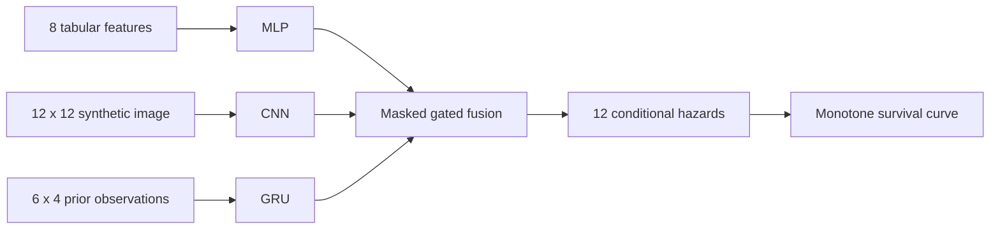

# Multimodal Survival Learning

Censoring-aware neural survival curves from tabular, image, and longitudinal inputs.

[](https://github.com/aymaw/multimodal-survival/actions/workflows/ci.yml)


[](LICENSE)

**New personal engineering work, November 2026.** Original, AI-assisted portfolio
implementation with synthetic task data. This is not historical research code,
employer software, or a deployed product. See [provenance](PROVENANCE.md).

## Engineering focus

An independent PyTorch implementation motivated by multimodal survival research.
A tabular MLP, small CNN, and GRU produce modality embeddings; an availability-aware
gate fuses them into 12 discrete hazard logits. Modality dropout improves robustness
to missing inputs. Single-modality models are retrained as ablations.



The likelihood uses the event hazard in the observed event bin and survival in
preceding bins. A censored subject contributes survival through its censor bin;
censoring is explicitly at the bin's end. Stable `logsigmoid` avoids log(0).
There is no proportional-hazards assumption. Time is a fictional 0–11 bin index.
## Reproduce

```bash
# Python 3.11–3.13; uv.lock pins the complete dependency graph.
uv sync --frozen --extra dev
uv run pytest -q
```

Alternatively, `python -m pip install -e '.[dev]'` installs the exact direct
dependencies from `pyproject.toml`, while resolving transitive dependencies.
CPU is the reference execution device. Full runs and checkpoints go to ignored
`runs/`; committed `results/` contains measured reports and provenance only.

```bash
uv run python -m multisurv.train
# Quick network-free end-to-end check:
uv run python -m multisurv.train --n 160 --epochs 2 --seeds 7 --modes fusion --out runs/smoke
```

## Measured reference experiment

CPU, 1,200 synthetic subjects; 720/240/240 train/validation/test; 45 epochs;
seeds 7, 19, 31. Checkpoint selected by validation NLL. The same fixed data split
is used for all modes and seeds. Training-seed variation is not an independent
cohort uncertainty estimate. Per-run subject-bootstrap intervals and IPCW Brier
scores are in [the raw report](results/metrics.json).

| Model | Test C-index, mean ± training-seed SD | Test NLL |
|---|---:|---:|
| tabular | 0.619 ± 0.011 | 1.865 |
| image | 0.591 ± 0.003 | 1.933 |
| sequence | 0.624 ± 0.004 | 1.884 |
| fusion | 0.732 ± 0.002 | 1.741 |

The fusion advantage is expected: the generator intentionally distributes latent
risk across modalities. This does not demonstrate a clinical benefit. Bootstrap
intervals condition on one synthetic generator and one cohort split.

## Evaluation and leakage controls

- Split subject indices before fitting tabular normalization; save fitted statistics.
- Features are generated before outcomes and represent only information available
  at time zero. No post-outcome feature construction or real clinical timelines.
- C-index uses strictly ordered observed times, gives tied risks half credit, and
  returns null if there are no comparable pairs. Same-time event pairs are excluded.
- IPCW Brier uses a reverse Kaplan–Meier censor distribution fitted on training data,
  with event-before-end-of-bin-censor ties. Unsupported horizons return null.
  Independent censoring is a generator assumption, not a claim about real cohorts.
- Missing modality embeddings receive zero fusion weight. Tests cover likelihood
  gradients, censoring boundaries, split isolation, curve monotonicity, and masking.

## Navigate the implementation

| File | Responsibility |
|---|---|
| `src/multisurv/data.py` | Seeded cohort, subject split, train-only preprocessing |
| `src/multisurv/model.py` | Encoders, availability gate, hazard likelihood |
| `src/multisurv/metrics.py` | Concordance, reverse KM, IPCW Brier, bootstrap |
| `src/multisurv/train.py` | Ablations, optimization, checkpoint selection, reports |

The implementation is intentionally small and auditable. It does not include
competing risks, time-varying prediction after baseline, external validation,
causal interpretation, or a treatment recommendation. The fictional images are
latent-signal patterns, not pathology slides. This repository contains no CHOP
data or historical CHOP source code.

## Method references

- Gensheimer & Narasimhan, [A Scalable Discrete-Time Survival Model for Neural Networks](https://arxiv.org/abs/1805.00917).
- [PyTorch numerical functions](https://docs.pytorch.org/docs/stable/torch.html).

Original code and synthetic data: [MIT](LICENSE). Contributions: [guide](CONTRIBUTING.md).
